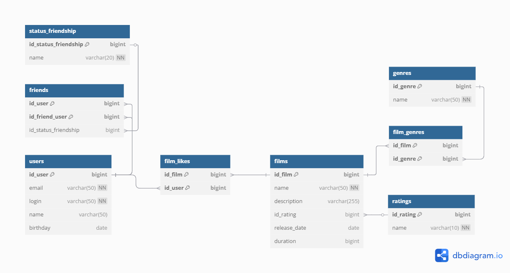

**Filmorate**

📌 **Описание проекта**  
**Filmorate** — сервис управления пользовательскими предпочтениями в области кино. Пользователи могут отмечать лайками понравившиеся картины, добавлять друзей и находить самые популярные фильмы.  

**Схема базы данных:**  

📂 **Архитектура**  
&nbsp;&nbsp;●&nbsp;**Storage-уровень**: реализация через **JdbcTemplate**, обобщённый базовый класс BaseDbStorage<T> для типовых операций  
&nbsp;&nbsp;&nbsp;(insert, update, delete, findOne, findMany).  
&nbsp;&nbsp;●&nbsp;**DbStorage-классы**: отдельные **DAO** для пользователей, фильмов, жанров и рейтингов.  
&nbsp;&nbsp;●&nbsp;**Сервис-уровень**: бизнес-логика, валидация данных, обработка ошибок (ValidationException, NotFoundException).  
&nbsp;&nbsp;●&nbsp;**Контроллеры**: **REST API** для пользователей, фильмов, жанров и рейтингов.  

⚙️ **Функционал**  
**Пользователи**  
&nbsp;&nbsp;●&nbsp;Создание нового пользователя.  
&nbsp;&nbsp;●&nbsp;Обновление данных пользователя.  
&nbsp;&nbsp;●&nbsp;Получение информации обо всех пользователях.  
&nbsp;&nbsp;●&nbsp;Получение пользователя по id.  
&nbsp;&nbsp;●&nbsp;Добавление в друзья.  
&nbsp;&nbsp;●&nbsp;Удаление из друзей.  
&nbsp;&nbsp;●&nbsp;Получение списка друзей пользователя.  
&nbsp;&nbsp;●&nbsp;Получение списка общих друзей двух пользователей.  
**Фильмы**  
&nbsp;&nbsp;●&nbsp;Добавление нового фильма.  
&nbsp;&nbsp;●&nbsp;Редактирование фильма.  
&nbsp;&nbsp;●&nbsp;Получение информации обо всех фильмах.  
&nbsp;&nbsp;●&nbsp;Получение фильма по id.  
&nbsp;&nbsp;●&nbsp;Лайк фильма пользователем.  
&nbsp;&nbsp;●&nbsp;Удаление лайка у фильма.  
&nbsp;&nbsp;●&nbsp;Получение списка популярных фильмов (сортировка по количеству лайков, с ограничением по count).  
**Жанры**  
&nbsp;&nbsp;●&nbsp;Получение списка всех жанров.  
&nbsp;&nbsp;●&nbsp;Получение жанра по id.  
**Рейтинги MPA**  
&nbsp;&nbsp;●&nbsp;Получение списка всех рейтингов.  
&nbsp;&nbsp;●&nbsp;Получение рейтинга по id.  

🛠️ **Стек технологий**  
&nbsp;&nbsp;●&nbsp;Java  
&nbsp;&nbsp;●&nbsp;Spring Framework (Boot, MVC)  
&nbsp;&nbsp;●&nbsp;JDBC Template  
&nbsp;&nbsp;●&nbsp;Spring Test  
&nbsp;&nbsp;●&nbsp;H2  
&nbsp;&nbsp;●&nbsp;Git  
&nbsp;&nbsp;●&nbsp;Postman (тестирование API)  
&nbsp;&nbsp;●&nbsp;REST  
&nbsp;&nbsp;●&nbsp;Maven  

